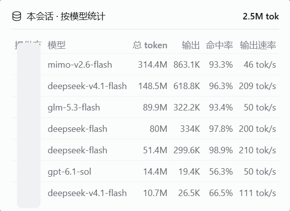

# dsh-model-stats 按模型用量

在 DSH 对话界面**输入框那一排**（宿主统计条旁）加一个小面板：
按 **提供方 / 模型** 分列显示 —— **总 token、缓存读、未缓存输入、输出、缓存命中率、输出速率(tok/s)**。

一个对话里换过几个模型时，宿主自带的统计只给**整会话汇总**，不按模型拆；本插件补上这个缺口。

## 面板长什么样

输入框那排的宿主统计条旁，多出一颗「N 个模型 · X 输出」药丸：


点药丸展开，按提供方/模型分列（截图已脱敏，提供方列遮挡）：



表格列：

| 提供方 / 模型 | 总 token | 缓存读 | 未缓存输入 | 输出 | 命中率 | 输出速率 |
|---|---|---|---|---|---|---|
| mimo-v2.6-flash | 41.1M | 40.0M | 933K | 180K | 97.7% | 58 tok/s |
| deepseek-v4.1-flash | 21.3M | 20.8M | 273K | 208K | 98.7% | 223 tok/s |

## 口径（与宿主一致，不是自创）

| 指标 | 算法 | 对齐的宿主口径 |
|---|---|---|
| 缓存命中率 | 缓存读 ÷（缓存读 + 未缓存输入） | `ui-chat` 的 `formatCacheHitPercent(cacheReadTokens, totalTokens - outputTokens)` |
| 输出速率 | 输出 token ÷ 解码耗时 | `dsh-session-stats` 的 `decodeTokens / decodeMs`，其中解码耗时 = 消息完成时刻 − 首个流式帧时刻 |
| 模型归属 | `assistant/message` 事件的 `data.message.source.model` | 实测全量覆盖 |

## 架构

- **宿主半** `lib/index.js`：注册只读路由
  `GET /plugins/dsh-model-stats/stats?sessionId=…`，读
  `DSH_HOME/sessions/**/<sessionId>/session.v4.jsonl.zstd`，解 zstd 帧后折叠。
  按 `(mtime, size)` 缓存折叠结果，5 秒轮询不会反复解压。
  纯读：不改会话日志、不调用模型、不写盘。
- **客户端半** `lib/client.js`：往 `conversation.composer.dock`
  （`kind:list, scope:session`）注入面板，`inject: (sessionId) => ({ sessionId })`
  直接拿到当前会话 ID，每 5 秒拉一次路由。

**安全**：路由带回环守卫（`Host` + `Origin` 都必须是回环地址），与
`dsh-workbuddy-bridge` 的 credit 路由同一口径，防 DNS 重绑定。

## 运行时要求

- **Node ≥ 24**（`zlib.zstdDecompressSync`）。DSH 自带的 node 满足；
  若系统全局 node 低于 24 则**没有 zstd** —— 别拿它跑。

## 卸载

```
dsh plugin --profile desktop remove dsh-model-stats
```

（跑之前确认 DSH 桌面端已完全退出。）

## 已知限制

- 面板只统计**已写盘**的用量，不是实时流；每 5 秒刷新一次。
- 解压/折叠只在会话文件 `(mtime,size)` 变化时重算。
- 面板渲染在 composer dock，紧凑模式的宿主统计条仍然并排存在 —— 不隐藏宿主任何东西。

## 开关（两种，分工不同）

| 想干嘛 | 在哪 | 效果 | 生效方式 |
|---|---|---|---|
| **只隐藏面板**（数据不丢） | 输入框那排按模型统计条，点右侧 **⏸** | 面板消失、**停止 5 秒轮询**；宿主路由仍在但只是按 (mtime,size) 缓存读 | **即时**，localStorage 持久，跨会话跨刷新记住 |
| **彻底停用整个插件** | 侧栏 → **插件** → 已安装 → `dsh-model-stats` 组合包开关 | 往 `cordis.patch.yml` 写 `disabled: true`，宿主路由 + 客户端面板**都停** | 热重载；若提示 `restart-required` 则重启一次 |

重新打开面板：点 **「按模型统计 · 已关 ▶」**；或控制台执行 `dshModelStats.on()` / `dshModelStats.off()`（即时生效，不用重启）。

> DSH 自带的 `设置 → 插件列表` 是**只读**的（“查看插件，而不改变其配置”），开关在**侧栏的「插件」页**（`remote.pluginManager.setBundleEnabled` / `setPluginEnabled`，写完 patch 会热重载）。

### 改代码后必须重装

`dsh-manifest` 是 `file:` 依赖，pnpm 是**拷贝**不是软链——改了 `lib\client.js` 或 `lib\index.js` 后必须：

```
dsh plugin --profile desktop remove dsh-model-stats
dsh plugin --profile desktop add file:../../plugins/dsh-model-stats
```

（cwd = `$DSH_HOME/profiles/desktop`，env 要带 `DSH_HOME` 指向你的 DSH 主目录，否则报「profile 未初始化」）

## 提供方缩写

提供方列显示缩写，悬停可看全名。默认表只收常见官方套餐/coding plan：

| 提供方 | 缩写 |
|---|---|
| `deepseek` / `deepseek-account` / `deepseek-official` | ds |
| `zai`（智谱） | z |
| `glm-coding`（智谱编码套餐） | glm |
| `kimi` / `moonshot`（月之暗面） | km |
| `xiaomi-plan` / `xiaomi`（小米） | xmt / xm |
| `minimax` | mm |
| `qwen`（通义） | qw |
| 未登记的提供方 | 首字母小写（兜底） |

中转站等私有提供方不进默认表，控制台一行即可本机自定义（localStorage 持久，刷新生效）：

```js
localStorage.setItem("dsh-model-stats:provAbbr", JSON.stringify({"my-relay":"mr"}))
```

## 版本历史

| 版本 | 改动 |
|---|---|
| 0.9.0 | 去除硬编码本机路径，只认 `DSH_HOME`；缩写默认表只保留常见官方套餐，私有提供方改走 localStorage 自定义 |
| 0.8.0 | 提供方缩写表（默认收录常见套餐，3 字母码列宽自适应） |
| 0.7.0 | 新增提供方列：聚合键改为 provider+model，同名模型来自不同提供方时分行显示 |
| 0.5.2 | 弹层删除页脚，只保留标题+表格 |
| 0.5.1 | 触发器去掉小箭头，只留图标+标签 |
| 0.5.0 | 根节点挂 `data-composer-stats`，与 composer-glass 毛玻璃胶囊联动（玻璃开关同进同出） |
| 0.4.0 | 弹层对齐宿主 stat-dialog：点击外部/Esc 关闭、portal 到 body、锚定自动定位并夹视口；面板列数定为 5 列（缓存明细进悬停提示） |
| 0.3.0 | 样式重写：药丸/配色/字号全部走宿主 StatsPills 规格与 `--dsw-alias-*` 主题变量，浅色/深色自动适配 |
| 0.2.0 | 面板级开关（localStorage 持久，刷新记住） |
| 0.1.0 | 初版：按模型折叠会话用量，补宿主统计不按模型拆分的缺口 |
